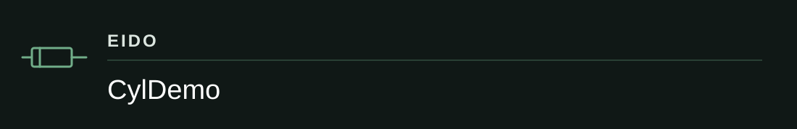

<!-- EIDO repository presentation. Detailed technical documentation is preserved below. -->
<p align="center"></p>

# CylDemo

**Object-oriented cylinder control · Siemens and C#**

<p align="justify">An educational side-by-side implementation of cylinder control using C# objects and Siemens PLC-native FB/UDT/FC structures.</p>

[](LICENSE)

**Maintained by [EIDO Automation](https://github.com/EidoAut).** Available under the [MIT license](LICENSE). Consult the usage requirements, supported targets and limitations documented below.

## Project documentation

This repository contains **two parallel implementations** of the same didactic architecture:

- **TIA Portal (PLC)**: OOP-style design using **FBs (objects)**, **UDTs (data interfaces)**, and **FCs (stateless static helpers)**.
- **C# / Visual Studio**: Real OOP implementation using **interfaces**, **classes**, **composition**, and **static helper methods**.

<p align="justify">The goal is to show how a clean, object-oriented design can be expressed in PLC-native constructs and then mapped 1:1 to C#.</p>

---

## Repository layout

```
.
├─ tia-source/
│  └─ TIA_CylDemo/                 # exported SCL/UDT/DB sources (text)
│     ├─ Plc data types/           # UDT interfaces + implementation data
│     └─ Program blocks/           # FBs + FCs (+ DB export)
│
├─ csharp/
│  └─ CylinderDemo/                # Visual Studio solution (.sln + project)
│
└─ docs/                           # optional diagrams / screenshots
```

> Tip: keeping the **TIA source exports** as text allows Git diffs and code review.

---

## PLC and C# mapping (mental model)

| PLC / TIA Portal                  | C# / Visual Studio                      |
|----------------------------------|-----------------------------------------|
| OB1 (cyclic scan)                | `Program.cs` main loop                  |
| FB (Function Block)              | `class`                                 |
| Multi-instance FB                | object composition (member objects)     |
| UDT data interface (`UDT_I*`)    | C# `interface` (`IActCmd`, `IActStatus`)|
| FC (stateless helper)            | `static` helper methods                 |
| `firstScan` initialization       | constructor                             |
| Watch table / DB monitoring      | console watch output                    |

---

## Build & run (C#)

Open `csharp/CylinderDemo/CylinderDemo.sln` in Visual Studio and run.

Console controls:
- `1` select CylA (pneumatic), `2` select CylB (electric)
- `E` extend selected cylinder
- `R` retract selected cylinder
- `P` toggle `PressureOk` (affects CylA)
- `Q` quit

---

## Use in TIA Portal

The PLC content in `tia-source/TIA_CylDemo/` is stored as exported text:
- `*.scl` for FB/FC code
- `*.udt` for UDT type definitions
- `*.db` for the instance DB export

To import into TIA:
- Create a new project (same TIA version as used originally).
- Import the exported blocks and data types (via **External source files** or **Import** depending on your workflow/version).
- Compile, then call `FB_Cylinder` from OB1.

---

## Git housekeeping

This repo includes a `.gitignore` suitable for:
- Visual Studio (`bin/`, `obj/`, `.vs/`)
- common OS/editor artifacts

<p align="justify">TIA exports are text and are meant to be tracked.</p>

